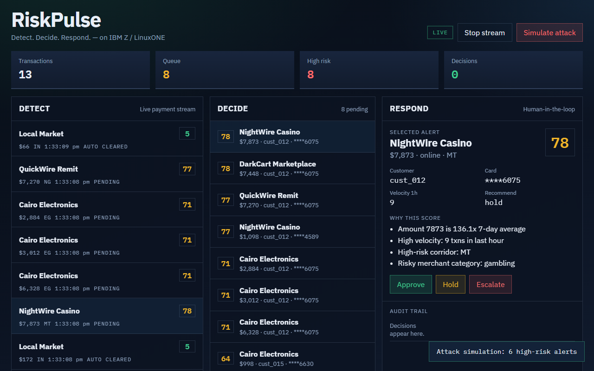
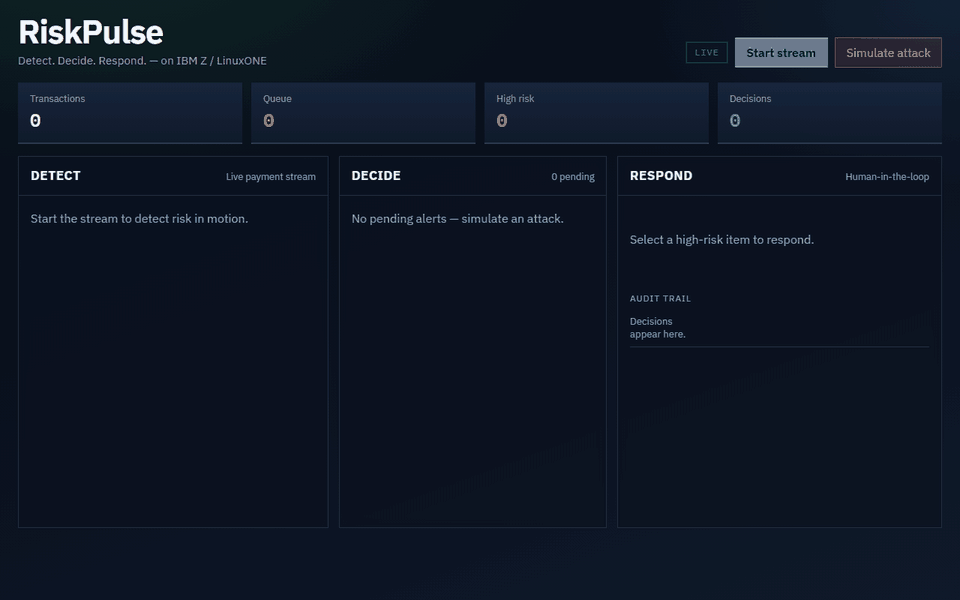
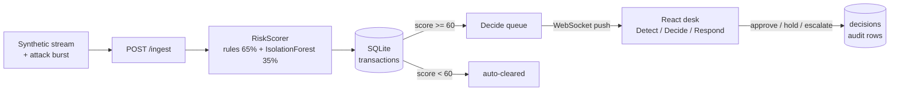

# RiskPulse

**A real-time payment risk desk: score each transaction with rules plus an anomaly model, queue the risky ones, and let a person decide.**

[](https://github.com/JamesKevinJones/riskpulse/actions/workflows/ci.yml)
[](LICENSE)



<sub>The desk running locally against the live API, after "Simulate attack". All transactions are synthetic, from the app's own generator.</sub>

Built for the **IBM Z Datathon 2026** (track: Real-Time AI for Critical Decisions) and packaged to run on IBM Z / LinuxONE: one FastAPI service and one React desk, in Docker.

## Why

Fraud models are good at ranking transactions and bad at explaining them, and an
analyst who can't see *why* a payment was flagged can't act on it quickly or
defend the decision later. RiskPulse scores every payment as it arrives, shows the
reasons next to the score, and keeps the model in an advisory role: it recommends,
a person approves, holds or escalates, and every decision is written to an audit
table.



## How it works



- **Rules carry the explanation, the model catches combinations.** Six rules
  (amount vs the 7-day average, velocity, corridor, merchant category, new
  merchant, large online payment) produce the reasons an analyst reads. An
  IsolationForest adds 35% of the score for odd combinations no single rule
  names. The trade-off: the blend is only as good as the model's range, which
  turned out to be narrow (see Limitations).
- **The model recommends; a person decides.** Nothing is blocked automatically.
  Scores of 60 and above wait in the queue, and only an operator's action changes
  their status.
- **Push, not poll.** New alerts and decisions reach the desk over a WebSocket, so
  the queue updates the moment the API scores a payment.
- **SQLite on purpose.** One file, zero operations, enough for a single-node
  datathon box. The ceiling is one writer at a time.
- **A browser-only fallback.** With no API reachable, the desk runs a simulator in
  the page (`frontend/src/demoEngine.js`) and says so in the header, so a
  static host can still show the UI.

## Measured behaviour

Measured 21 Oct 2026 at commit `5f12feb` with the committed model
(`backend/models/isolation_forest.joblib`, scikit-learn 1.6.0) on seeded traffic
from the app's generator, on a Windows 11 laptop, $0. The first two rows are the
seeded run that `tests/test_scorer.py` asserts (`python -m pytest -q` in
`backend/`). The last two came from a one-off script over the same generator
(seeds 7 and 1) and are not part of the test suite.

| Traffic | Queued (score >= 60) | Recommended action |
|---|---:|---|
| 300 normal transactions | **0** (max score 10) | approve |
| 300 risky transactions | **291** (97%) | hold, a few approve |
| 300 attack-burst transactions | **300** (min score 69) | hold |
| 3,500 risky and attack transactions | | **escalate: 0 times** |

That last row is a known gap, not a feature: see Limitations.

## Quick start

With Docker, from a fresh clone:

```bash
git clone https://github.com/JamesKevinJones/riskpulse.git
cd riskpulse
docker compose up --build
```

Open http://localhost:5173, click **Start stream**, then **Simulate attack**, then
pick an alert. The API is on http://localhost:8000 (`/health`, `/docs`).

<details>
<summary><b>Without Docker (Python 3.11+ and Node 20.19+)</b></summary>

```bash
cd backend
python -m venv .venv && .venv/Scripts/activate      # macOS/Linux: source .venv/bin/activate
pip install -r requirements.txt
uvicorn app.main:app --port 8000
```

In a second terminal:

```bash
cd frontend
npm install
npm run dev
```

Open http://localhost:5173. Vite proxies `/api` and `/ws` to the backend.

</details>

## API

| Endpoint | Purpose |
| --- | --- |
| `GET /health` | Liveness, threshold, stream state |
| `POST /ingest` | Score and store one transaction |
| `GET /queue` | Pending alerts, highest score first |
| `POST /transactions/{id}/decide` | Approve, hold or escalate (once) |
| `GET /decisions` | Audit trail |
| `POST /stream/start`, `/stream/stop` | Synthetic live feed |
| `POST /demo/attack` | Inject a high-risk burst |
| `WS /ws` | Live alerts and decisions |

## Tests and CI

```bash
cd backend
pip install -r requirements.txt -r requirements-dev.txt
python -m pytest -q
```

17 tests and 1 expected failure, about 8 s. They cover the scorer (approve path,
reasons, caps, a customer with no history, deterministic retraining, and the
separation in the table above), the API end to end against an in-memory SQLite
database (queue order, hold and its audit row, double decisions, unknown ids,
invalid input, the attack burst), and the UI fallback route. The expected failure
is the escalation gap below, recorded as a strict `xfail` so it flips the day it
is fixed.

CI runs those tests on Python 3.11 and lints and builds the frontend on Node 22,
the versions the Dockerfiles use.

## What broke, and what I learned

The demo link in this README went dead: the Vercel UI-only deploy now returns 404,
so it is gone from here rather than left to fail in front of a reviewer. Writing
tests for this review turned up two real problems. The single-container image (the
root `Dockerfile`, built for a Hugging Face Space) served the UI through a
catch-all route that joined the request path onto the static folder unchecked, and
Starlette hands that route a percent-decoded path, so `GET /..%2Fapp%2Fmain.py`
returned the API's source and `/..%2F..%2Fetc%2Fhostname` the container's hostname.
The path is now resolved and must stay inside `static/`, checked against the built
image before and after. The second problem is still open: the escalate band is
unreachable, because the anomaly score never gets past about 43. Two likely
causes, neither tested yet: the model was trained on synthetic data that already
includes an attack cluster, and the mapping `(0.25 - raw) * 120` needs decision
values an IsolationForest rarely produces. A test that only checks "risky things
get queued" passes happily; it took counting the recommended actions to see it.

## Limitations

- **Escalate is effectively never recommended.** The anomaly score tops out near
  43, so the 0.65/0.35 blend reaches 80 only if every rule fires and the model
  hits that maximum at the same time. Across 3,500 generated risky and attack
  transactions it never did. Operators can still escalate by hand. Fixing it means retraining or rescaling the model, which is
  a modelling decision, not a polish fix.
- **Synthetic data only.** The model was trained on, and is demonstrated with,
  generated transactions. Nothing here has seen a real payment.
- **New customers look risky.** With no 7-day history (`avg_amount_7d` of 0) the
  average is floored to 1, so a $45 coffee reads as "45x 7-day average".
- **Demo-grade API.** No authentication, CORS open to all origins, and the
  operator name is free text. Fine for a datathon desk, not for production.
- **Not verified on LinuxONE.** The containers are standard Linux images and the
  [LinuxONE runbook](docs/linuxone-runbook.md) describes the event-day steps, but
  no run on s390x is recorded here.

More: [architecture](docs/architecture.md) · [pitch script](docs/pitch-script.md)

## Licence

MIT. See [LICENSE](LICENSE).
